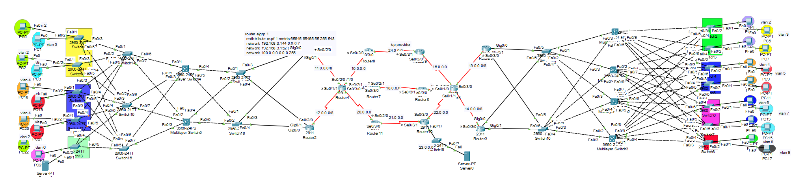

# Two-Company Enterprise Network Design


An enterprise network designed and simulated in **Cisco Packet Tracer**. It connects two company sites through an ISP network, with VLAN segmentation, dynamic routing, redundant switching links, and secure connectivity.

## Network Topology



*Click the image to view it in full size.*

## Project Objectives

- Connect two company networks over an ISP.
- Segment each network into VLANs and allow controlled communication between them.
- Improve availability with redundant links between switching layers.
- Secure traffic using VPN tunnels and access control lists.

## Key Features

| Area | Implementation |
|---|---|
| Segmentation | VLANs 2–9 |
| Inter-VLAN communication | Inter-VLAN routing |
| IP address assignment | DHCP |
| Dynamic routing | OSPF and EIGRP with route redistribution |
| WAN | ISP connectivity over serial links |
| Security | VPN tunnels and ACLs |
| Availability | Redundant links between switching layers |
| Services | Servers integrated into the topology |

## Technologies Used

- **Simulation:** Cisco Packet Tracer
- **Devices:** Cisco 2911 routers, 3560 multilayer switches, 2960 switches, PCs, and servers
- **Protocols and concepts:** TCP/IP, subnetting, VLANs, DHCP, OSPF, EIGRP, route redistribution, VPN, ACLs

## Repository Contents

| File | Description |
|---|---|
| `Enterprise-Network.pkt` | Packet Tracer project file |
| `Enterprise-Network.png` | Topology screenshot |
| `README.md` | Project documentation |

## How to Run

1. Install [Cisco Packet Tracer](https://www.netacad.com/cisco-packet-tracer).
2. Download `Enterprise-Network.pkt` from this repository.
3. Open the file and wait for the links to come up.
4. Test connectivity between end devices using `ping`.

## Useful Verification Commands

```text
show vlan brief
show ip interface brief
show ip route
show ip ospf neighbor
show ip eigrp neighbors
show access-lists
show ip dhcp binding
```

## Author

**Ahmed Osama**
IT Operations | Network Security

[LinkedIn](https://www.linkedin.com/in/ahmed-osama-6a6a972a4) · [GitHub](https://github.com/ahmedosama2410)
